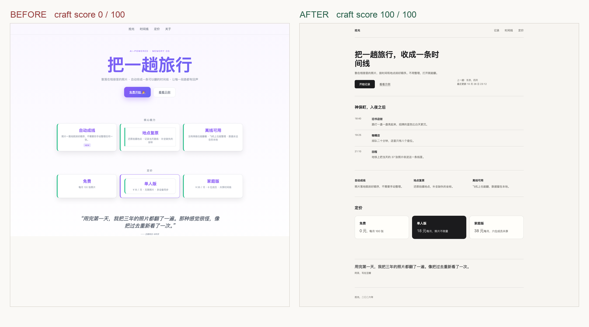

# de-ai-ui

**让 AI 生成的界面不再「一眼廉价」——一个 skill + 一个零依赖检查器 + 一份可复现的 A/B 证据。**

> vibe 出来的界面一眼廉价，往往输在细节上。—— [@bruc3van](https://x.com/bruc3van/status/2115963644811116732)

[](https://github.com/NPC-NICEPEOPLEC/de-ai-ui/actions/workflows/ci.yml)



> 左边和右边是同一个产品（拾光）、同一段文案，只差工艺。两份源码分别在 [`examples/before.html`](examples/before.html) 与 [`examples/after.html`](examples/after.html)，分数由 `scripts/slop-lint.mjs` 算出，不是手写的。

---

## 它解决什么

AI 写界面不是「审美差」，而是三种**可以测出来**的失败：

| 失败 | 现场 | 本仓库的解法 |
|---|---|---|
| 加法过度 | 分割线、标签、emoji、解释文案层层叠加 | 生成前的 5 行契约 + 加法闸门 |
| 几何不精确 | 嵌套圆角不同心、该 0.5px 用了 1px、图标粗细不一 | 圆角公式 + 4px 网格 + 0.5px 描边 |
| 没有系统 | 一卡一色、字号随手定、硬编码内联样式 | token 化 + 确定性检查器 |

大多数「去 AI 味」的规则清单停在「看着像」的层面，无法验收。这里的每个结论都落到 `scripts/slop-lint.mjs` 的一条规则上，**能跑出分数、能对比、能进 CI**。

## 60 秒开始

```bash
git clone https://github.com/NPC-NICEPEOPLEC/de-ai-ui.git
cd de-ai-ui

# 1. 看看「AI 味」和「做出了质感」的差距（同一个产品、同一段文案）
open examples/before.html examples/after.html

# 2. 量一下
node scripts/slop-lint.mjs examples/before.html   # 0/100
node scripts/slop-lint.mjs examples/after.html    # 100/100

# 3. 检查你自己的项目
node scripts/slop-lint.mjs src --fail-under 85
```

零依赖，只要 Node ≥ 20。

## 怎么用这个 skill

三种方式，任选：

**A. 作为一个 skill 安装**（Claude Code / Codex / 其他 agent runtime）

```bash
# Claude Code（个人级）
git clone https://github.com/NPC-NICEPEOPLEC/de-ai-ui.git ~/.claude/skills/de-ai-ui

# 跨 runtime 的通用位置
git clone https://github.com/NPC-NICEPEOPLEC/de-ai-ui.git ~/.agents/skills/de-ai-ui

# DeepSeek Harness
git clone https://github.com/NPC-NICEPEOPLEC/de-ai-ui.git ~/.dsh/skills/de-ai-ui
```

下次 agent 遇到「界面有 AI 味 / 看起来廉价 / 帮我做个落地页」时会自己找到它。

**B. 直接贴给 AI**
把 `SKILL.md` 的内容贴进对话，或让它先读这个文件。`SKILL.md` 里的「可直接粘贴的 Prompt」一段也够用。

**C. 只用检查器**
不装 skill，把它当 lint 用：`node scripts/slop-lint.mjs . --fail-under 85`，接进 CI。

## 证据：真实 A/B 压测

同一个模型、同一句任务提示、每个实验组 3 次，唯一差别是**有没有读这个 skill**：

```bash
bash bench/score.sh   # 用仓库内的样本复现下面的数字
```

| 组 | 样本 | craft score | 发现数 | P1 | P2 |
|---|---|---|---|---|---|
| 无 skill（基线） | `bench/samples/red-1.html` | 34 | 39 | 30 | 9 |
| 无 skill（基线） | `bench/samples/red-2.html` | 37 | 44 | 33 | 11 |
| 无 skill（基线） | `bench/samples/red-3.html` | 45 | 35 | 23 | 12 |
| **均值** | | **38.7** | **39.3** | **28.7** | **10.7** |
| 读 skill 后 | `bench/samples/green-1.html` | 100 | 0 | 0 | 0 |
| 读 skill 后 | `bench/samples/green-2.html` | 100 | 0 | 0 | 0 |
| 读 skill 后 | `bench/samples/green-3.html` | 100 | 0 | 0 | 0 |
| **均值** | | **100.0** | **0** | **0** | **0** |

差值：craft score **38.7 → 100.0**，P1 发现 **28.7 → 0**。

基线的三个样本都「看起来还行」——它们不是乱码，而是**细节债务堆出来的假精致**：一个样本里出现 19 种字号、11 处中点分隔符、11 处 1px 边框、110px 的 hero。这正是「AI 味」的真实形态：不是难看，是**经不起细看**。

实验组的 100 分不是靠文风，而是靠 skill 的两件事：契约先把数值定死，审计闭环把剩下的收干净。三份样本在第一次审计时就已经零发现，后续只做了检查器覆盖不到的手工打磨（中文断行、320px 导航换行）。

方法、口径与局限写在 [`bench/RESULTS.md`](bench/RESULTS.md)。

## 仓库里有什么

```
SKILL.md                      # 入口：诊断模型 → 5 行契约 → 三道闸门 → 审计 → 修复
references/
  radius-and-borders.md       # 嵌套圆角公式、超椭圆、0.5px 与低分屏回退
  color.md                    # 黑白灰 chrome、Radix 12 级语义、品牌色配额
  typography-cjk.md           # 中文栈「先西后中」、字号阶梯、slop 字体
  copy-and-content.md         # 中点、解释文案、编造数据的替换写法
  motion-and-interaction.md   # 时长/曲线、下拉与按钮的四个细节
  assets-and-icons.md         # 图标体系、深色模式素材、资源库
  slop-checklist.md           # 交付前逐条自查（可打勾）
  sources.md                  # 每条规则的原始帖子与可信度标注
scripts/slop-lint.mjs         # 28 条规则，0–100 分，可进 CI
examples/
  before.html / after.html    # 同一个产品：0 分 vs 100 分
  tokens.css                  # 最小 token 起点
bench/                        # 压测方法与可复现样本
tests/                        # 检查器自身的测试（node:test）
```

## 检查器的 28 条规则

| 组 | 规则 | 检查什么 |
|---|---|---|
| 圆角 | `R001`–`R003` | 4px 网格、圆角种类数、事故圆角 |
| 颜色 | `C001`–`C003` | 紫渐变、渐变按钮、chrome 上的高饱和色系 |
| 字体 | `T001`–`T007` | 字号种数、12px 下限、slop 字体、全大写、中西文顺序、兜底、hero 过大 |
| 文案 | `Y001`–`Y004` | 中点分隔符、emoji、眉标、章节编号 |
| 边框 | `L001`–`L002` | 1px 该用 0.5px、卡片左边缘彩条 |
| 动效 | `M001`–`M003` | 超时、ease-in、transition: all |
| 布局 | `A001`–`A002` | 大面积居中、内联硬编码 |
| 素材 | `K001` `D001` | 图标库混用、卡片套卡片 |
| 可访问性 | `S001`–`S002` | 缺 lang、图片缺 alt |

分数 = 100 − Σ(权重 × min(出现次数, 2))，P0 12 / P1 5 / P2 2。默认 `--fail-under 80`，任何 P0 直接失败。

## 它不做什么

- **不替你决定风格。** 它约束的是工艺（几何、层级、一致性），不是「该做成什么样」。
- **不保证好看。** 100 分只代表没有已知的廉价特征，不代表有创意。
- **不做设计系统迁移。** 它指出问题，不重写你的组件库。

## 规则的出处

8 位设计师在 X 上的公开分享：[@Kubai087](https://x.com/Kubai087) [@ZaynHao](https://x.com/ZaynHao) [@ianneo_ai](https://x.com/ianneo_ai) [@dingyi](https://x.com/dingyi) [@Xian0063](https://x.com/Xian0063) [@yanliudreamer](https://x.com/yanliudreamer) [@ricouii](https://x.com/ricouii) [@remixdesigner](https://x.com/remixdesigner)。

代表帖、逐条核验过程、以及哪些是我的引申（标 `[判断]`）写在 [`references/sources.md`](references/sources.md)。

原帖里的 8 个链接是被截断的（只有 `x.com/<用户名>/status`，没有帖子 ID），作者本人也补充说明过。本仓库的对应帖子是**按作者和时间重新定位、并逐条抓取原文核对**的。

## English

**de-ai-ui** is a skill plus a zero-dependency linter that removes the tells that make AI-built interfaces look cheap: additive excess (dividers, labels, emoji, explanatory copy), geometric imprecision (non-concentric nested radii, 1px where 0.5px belongs, mismatched icon weights), and the absence of a token system.

Install it as a skill (`~/.claude/skills/de-ai-ui`, `~/.agents/skills/de-ai-ui`), paste `SKILL.md` into any chat, or use `scripts/slop-lint.mjs` as a CI check. The bench in `bench/` ships the same task run with and without the skill; every sample is re-scorable with `bash bench/score.sh`.

## License

MIT。规则来自公开分享的实践观点，引用仅用于标注出处；与原作者无隶属关系。
